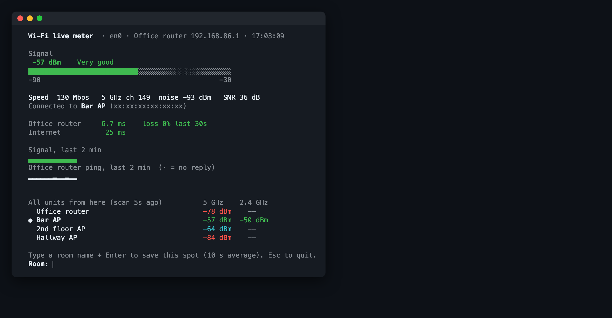
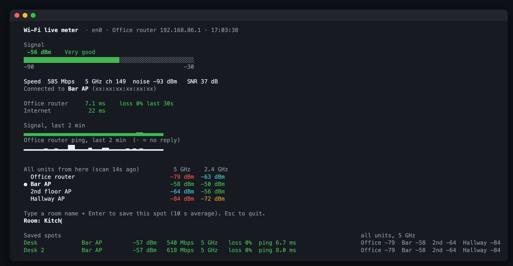

# wifi-live

A live Wi-Fi signal meter for macOS, for walking a laptop around the house and finding
weak spots in a mesh network.

Once a second it shows:

- signal strength, speed, band, channel, noise and SNR
- which mesh unit (router or access point) you're connected to, and when you switch
- live pings to the router and the internet, sent over Wi-Fi even if a cable is plugged in
- a 2-minute history of signal and router ping
- every unit's signal from where you're standing, on 5 GHz and 2.4 GHz

Type a room name and press Enter to save that spot (a 10-second average plus a fresh scan
of all units) to `wifi_survey.csv`.





## Requirements

- macOS
- Go 1.26+ and the Xcode command line tools (`xcode-select --install`), for `swiftc`,
  `codesign` and cgo

## Build

```sh
git clone https://github.com/wujiang/wifi-live.git
cd wifi-live
make
```

This builds two things into the repo folder, which must stay side by side:

| File | What it is |
| --- | --- |
| `wifi_live` | The meter itself. Reads signal, speed and channel from Apple's CoreWLAN. |
| `WifiInfo.app` | A small background helper, explained below. |

## Configure your units

Copy the example config and list your router and access points. The first unit is the one
that gets pinged.

```sh
cp wifi_live.example.json wifi_live.json
```

```json
{
  "internet": "1.1.1.1",
  "units": [
    {"name": "Router", "ip": "192.168.1.1", "mac": "aa:bb:cc:00:00:01"},
    {"name": "Kitchen AP", "ip": "192.168.1.20"}
  ]
}
```

- `ip` is each unit's LAN address. On startup `wifi_live` pings it and reads its MAC from
  the ARP table, then recognizes the unit's Wi-Fi access points (BSSIDs), which sit a few
  addresses above that MAC.
- `mac` is optional. It's used when a unit is offline or not in the ARP table.
- Without a `wifi_live.json`, the default gateway is used as the only unit.

`wifi_live.json` is git-ignored, so your addresses stay out of the repo.

## Run

```sh
./wifi_live
```

Type a room name and press Enter to save a spot. Press Esc or Ctrl+C to quit. Saved spots
go to `wifi_survey.csv` next to the binary.

### About WifiInfo.app

macOS only reveals which access point you're connected to (its BSSID), and the list of
nearby access points, to apps that have Location permission. Command-line programs can't
get that permission, so the helper app does that part and writes the results to small JSON
files next to itself, which `wifi_live` reads.

You don't need to start it yourself:

- `wifi_live` launches it in the background when it starts (`open -g WifiInfo.app`).
- The first time, macOS asks whether WifiInfo may use your location. Allow it. If you missed
  the prompt, turn on **WifiInfo** in System Settings › Privacy & Security › Location
  Services.
- It scans for all units every 20 seconds, and right away when you save a spot.
- It quits by itself after 10 minutes with no `wifi_live` running.

Without the permission, the meter still works but shows "Connected to: unknown" and no
table of all units.

## How the connected unit is recognized

Mesh units usually advertise BSSIDs derived from their wired MAC: the same first five
bytes, a last byte a few steps higher, and sometimes the locally administered bit set.
`wifi_live` matches on that, picking the unit whose MAC is closest.
